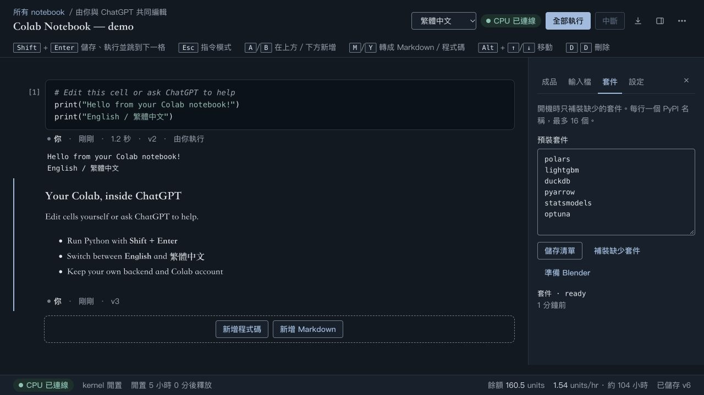
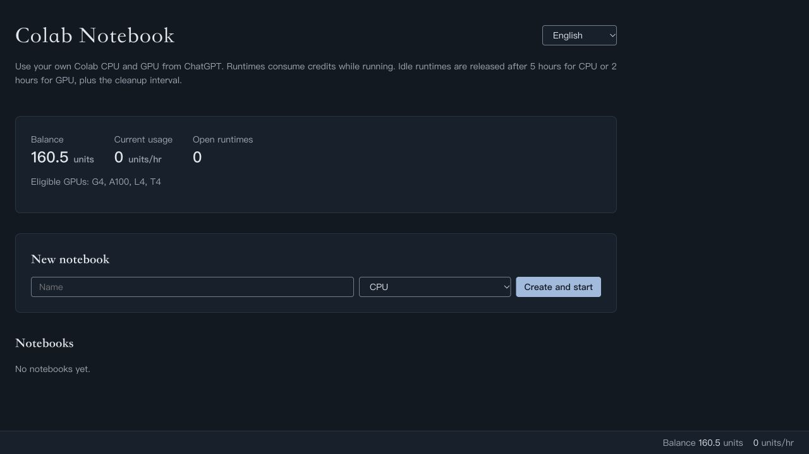
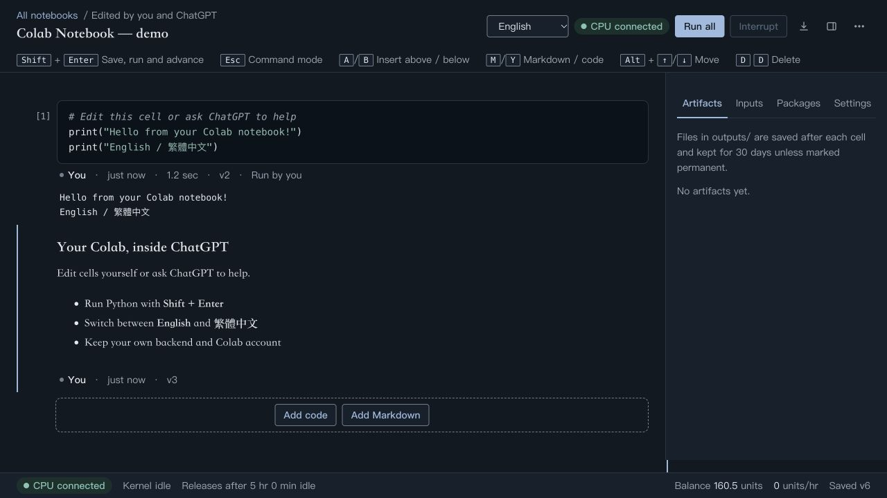

# chatgpt-colab-plugin

**在 ChatGPT 執行 Colab Notebook，使用你自己的 Colab 運算額度。**

[English](README.md) | [繁體中文](README.zh-TW.md)

直接在 ChatGPT 對話中編寫、修改與執行 Python Notebook；程式在你自己的 Google Colab runtime 執行，使用自己帳號可用的運算資源與額度。你可以手動編輯並按 Shift＋Enter，也可以請 ChatGPT 操作 Notebook。每位使用者部署自己的私人後端、設定自己的 Google OAuth，不共用作者的 Site、憑證或額度。

**非 Google 或 OpenAI 官方產品。此 repo 是可自行部署的實驗性整合，不是已上架的公開 Plugin，也不是共用運算服務。**

## 介面預覽

以下為本機示範資料與模擬運算數值，截圖未使用 Google 帳號或 Colab 額度。

**繁體中文編輯器：程式碼、輸出與套件側欄。**



<details>
<summary>查看首頁與英文介面</summary>

**首頁：輸入 Notebook 名稱並選擇機型。**



**英文編輯器：切換語言後仍保留程式碼與輸出。**



</details>

## 你會得到什麼

- 私人 Notebook 編輯器：程式碼、Markdown、Shift＋Enter、輸出與版本衝突處理。
- ChatGPT MCP 工具：開啟 notebook、編輯與執行 cell、匯入附件、匯出 `.ipynb`、下載成品。
- 自有 Google OAuth：瀏覽器授權，不需手動複製 access token 或 refresh token。
- 自有 Site、D1 資料庫、R2 成品儲存與私人 Plugin；repo 作者不代管你的帳號或後端。

```text
Your ChatGPT / Codex
        |
Your private Site + MCP + D1 + R2
        |
Your Google OAuth client -> Your Google account -> Your Colab runtime
```

## 開始使用

第一版支援 **ChatGPT Sites 私人部署**。你需要可建立 Site、使用 Sites Plugin 的帳號，以及自己的 Google Cloud 專案與 Colab 帳號。這不代表完全自行管理伺服器：後端由 Sites 平台代管，但每人有獨立實例。

1. Clone 本 repo；不要沿用別人的 Site 或 Google OAuth client。
2. 依 [部署指南](docs/DEPLOYMENT.md) 建立自己的私人 Site。
3. 依 [OAuth 指南](docs/OAUTH.md) 設定 Google Web client，在自己的瀏覽器完成授權。
4. 安裝／連接 Sites 為你建立的私人 Plugin。

可以把以下要求交給有 Sites 能力的 agent：

> 請讀取這個 repo 的 AGENTS.md、docs/DEPLOYMENT.md 和 skills/setup/SKILL.md，幫我部署到新建、僅本人可存取的 ChatGPT Site，設定我自己的 Google OAuth 並連接私人 Plugin。憑證由我在設定介面輸入，不貼進對話。先完成不啟動 runtime 的檢查。

介面提供 English／繁體中文切換，首次依瀏覽器語言選擇；可從首頁或編輯器工具列切換，瀏覽器允許儲存時會記住選擇。

Google 帳號授權與必要的設定仍需本人完成。這不是安裝後零設定的商店 Plugin。第一版不支援直接部署到一般 Cloudflare Worker 或任意 VPS；它依賴 Sites 的身分驗證邊界。

## 本機開發與驗證

需要 Node.js 22.13+、npm、uv（Python 測試環境）。

```sh
git clone https://github.com/KaiQin04/chatgpt-colab-plugin.git
cd chatgpt-colab-plugin
npm ci
npm ci --prefix ui
uv venv --python 3.12 .venv
uv pip install --python .venv/bin/python -r requirements-test.txt
npm run build:ui
npm run check
npm run build
```

`npm run dev:ui` 在 localhost 啟動合成資料預覽，不會連線 Google 或使用 Colab 額度。Python harness 使用本專案 `.venv/bin/python`；也可設定 `NOTEBOOK_TEST_PYTHON`。沒有 Python 時部分測試會跳過，不能當成完整驗證通過。

## 授權

[MIT](LICENSE)。第三方元件的原始授權保留在 [THIRD_PARTY_NOTICES.md](THIRD_PARTY_NOTICES.md)。ChatGPT、OpenAI、Google、Colab 名稱僅用於描述相容服務，不表示官方背書。
